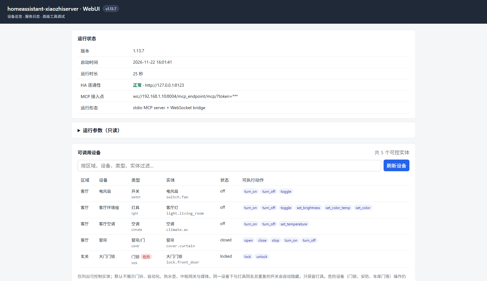

# homeassistant-xiaozhiserver

> 把 **Home Assistant** 的实体与服务封装成标准 **MCP（Model Context Protocol）** 工具，供 **小智（xiaozhi-server）** 通过 **MCP 接入点** 用自然语言查询和控制智能家居设备。

**当前版本：v1.15.11** · Python 3.12 · 传输方式：**stdio MCP server + WebSocket bridge** · 单容器部署（MCP bridge + WebUI）

---

## 目录

1. [项目简介](#1-项目简介)
2. [功能特性](#2-功能特性)
3. [架构与目录](#3-架构与目录)
4. [快速开始](#4-快速开始)
5. [WebUI](#5-webui)
6. [环境变量](#6-环境变量)
7. [MCP 工具](#7-mcp-工具)
8. [接入小智 MCP 接入点](#8-接入小智-mcp-接入点)
9. [自然语言示例](#9-自然语言示例)
10. [错误处理与排查](#10-错误处理与排查)
11. [离线测试](#11-离线测试)
12. [安全建议](#12-安全建议)
13. [版本记录](#13-版本记录)

---

## 1. 项目简介

`homeassistant-xiaozhiserver` 不是 Home Assistant 插件，而是一个**独立的 MCP 服务**：

- 对内连接 Home Assistant 的 REST API 与 WebSocket API；
- 对外暴露 7 个面向智能家居场景的 MCP 工具；
- 通过 `mcp_pipe.py` 以**主动出站**的 WebSocket 方式接入小智 `mcp-endpoint-server`；
- 同一个容器内同时运行 MCP bridge 与 WebUI，部署只需要一条 compose 命令。

典型链路：

```text
用户语音 → 小智 ASR/LLM → MCP 工具调用 → mcp_pipe.py → server.py → Home Assistant
```

> 设计目标是让模型用最少的工具调用完成控制：设备名能直接匹配时直接控制，不强制先查设备列表；控制成功后直接返回中文播报文本，减少一次 LLM 往返。

---

## 2. 功能特性

| 能力 | 说明 |
|---|---|
| 7 个 MCP 工具 | `list_devices`、`get_device_state`、`control_device`、`control_devices`、`list_services`、`call_service`、`list_domains` |
| 小智 MCP 接入点 | 只保留 stdio + WebSocket bridge；bridge 主动出站，不需要为 MCP 暴露入站端口 |
| 设备查询 | 支持名称、`entity_id`、`domain`、`area` 组合过滤，支持分页与按物理设备聚合 |
| 常用控制 | 开关、亮度、音量、温度、色温、颜色、窗帘、门锁等按 domain 自动映射 HA 服务 |
| 能力自描述 | `list_services` 先查设备支持的服务与字段，再用 `call_service` 精确调用 |
| 回读校验 | 控制后轮询状态与属性，返回 `confirmed` / `accepted` / `no_change` / `mismatch` / `accepted_pending` |
| 危险操作确认 | 门锁、安防面板、车库门/门窗 cover 及脚本类服务首次只返回 `confirm_token`，确认后才执行 |
| 按物理设备聚合 | 通过 HA WebSocket 注册表把同一设备的多个实体合并；注册表不可用时自动降级 |
| 设备范围收敛 | 默认隐藏门铃、自动化、热水壶、中枢网关、媒体五类设备，可通过环境变量调整 |
| 同名开关去重 | 同一设备下 1 个灯具与 1 个同名开关时，自动隐藏开关、只保留灯具；名称不同或数量无法唯一确定时保留并记录可疑组 |
| WebUI | `WEBUI_TOKEN` 登录、运行状态、按区域/类型展示的可调用设备、分进程服务日志、折叠的高级工具调试台、`/metrics` |
| 结构化错误 | 所有工具返回 JSON，失败带 `code` / `message` / `hint`，不抛异常堆栈、不使服务崩溃 |
| 离线可测 | 自带 fake HA 模拟器、stdio 端到端测试与 WebUI 冒烟测试 |

---

## 3. 架构与目录

### 3.1 运行架构

```text
小智后端（ASR → LLM → function calling）
  └─> mcp-endpoint-server（MCP 接入点，工具端 WebSocket）
        └─> mcp_pipe.py（WebSocket 客户端 ↔ stdio 桥接）
              └─> server.py（stdio MCP server，参数校验 + 7 个工具薄包装）
                    └─> devices.py（DeviceService：查询/状态/控制/服务业务层）
                          ├─> Home Assistant REST API
                          │     ├─ GET  /api/states
                          │     ├─ GET  /api/services
                          │     └─ POST /api/services/{domain}/{service}
                          └─> Home Assistant WebSocket API
                                ├─ /api/websocket（设备/实体/区域注册表）
                                └─ state_changed 事件流（状态缓存与确认）
```

一次典型调用：

1. `mcp_pipe.py` 启动时主动连接 `MCP_ENDPOINT`，随后以 stdio 启动 `server.py`；
2. 小智后端通过 MCP 接入点完成 `initialize` / `tools/list`，拿到 7 个工具；
3. 用户说话，LLM 选择工具与参数；
4. `tools/call` 经 bridge 传给 MCP server，再由 server 调用 HA REST/WS；
5. 结构化结果原路返回，小智直接播报或交给 LLM 组织回复。

> MCP bridge 不监听端口；容器使用 `network_mode: host`，WebUI 直接监听宿主机 `WEBUI_HOST:WEBUI_PORT`（默认 `0.0.0.0:8099`）。

### 3.2 目录结构

```text
homeassistant-xiaozhiserver/
├── homeassistant_xiaozhiserver/
│   ├── __init__.py                  # 版本号
│   ├── __main__.py                  # python -m 入口（stdio）
│   ├── settings.py                  # Settings 数据类：环境变量唯一解析入口
│   ├── config.py                    # 兼容导出层（旧常量名 → settings）
│   ├── metrics.py                   # 进程内指标（工具/HTTP）与 Prometheus 文本
│   ├── logging_setup.py             # 分进程日志、text/json 格式、call_id、尾部读取
│   ├── client.py                    # HA REST/WebSocket 客户端、状态事件流与缓存
│   ├── service.py                   # 动作映射、预期属性、回读校验
│   ├── danger.py                    # 危险设备判定与一次性确认令牌
│   ├── views.py                     # 实体摘要、可控标记、区域、按设备聚合
│   ├── devices.py                   # DeviceService 业务层（MCP 与 WebUI 共用）
│   ├── server.py                    # 7 个 MCP 工具薄包装与 stdio 进程入口
│   ├── webui.py                     # FastAPI WebUI：登录、API、缓存、指标
│   └── webui_page.py                # WebUI HTML 渲染（与路由逻辑分离）
├── server.py                        # 兼容入口，等价于 python -m homeassistant_xiaozhiserver
├── mcp_pipe.py                      # 小智 MCP 接入点 WebSocket ↔ stdio bridge
├── docker-entrypoint.sh             # 容器入口：WebUI 后台 + bridge 前台
├── Dockerfile                       # 单容器镜像
├── docker-compose.yml               # 单服务 compose
├── requirements.txt
├── .env.example
├── docs/
│   └── webui.png                    # WebUI 首页截图
├── tests/
│   ├── fake_ha.py                   # 离线 HA 模拟器（HTTP + WebSocket）
│   ├── e2e_mcp_client.py            # stdio 端到端 MCP 断言
│   ├── dedupe_switch_light.py       # 同名开关/灯具去重边界单测
│   ├── state_cache.py               # 状态/服务缓存、事件流与失效单测
│   ├── confirm_window.py            # 慢设备回读窗口单测
│   ├── env_consistency.py           # .env.example / .env / 代码读取三方一致性
│   ├── logging_fallback.py          # 日志目录不可写自动回退、无 Traceback 刷屏
│   ├── webui_smoke.py               # WebUI 登录与接口冒烟测试
│   └── run_local_test.sh            # 一键测试入口
└── README.md
```

### 3.3 模块职责

| 模块 | 职责 |
|---|---|
| `settings.py` | `Settings` 数据类与环境变量唯一解析入口；`config.py` 仅做兼容导出 |
| `config.py` | 保留旧常量名并转发到 `settings`，避免破坏既有导入 |
| `metrics.py` | 进程内计数器/直方图，`/metrics` 输出 Prometheus 文本 |
| `logging_setup.py` | 分进程日志文件、`text`/`json` 格式、版本号与 `call_id`、尾部日志读取 |
| `client.py` | HA REST/WS 封装、鉴权、错误归一化、注册表缓存、`state_changed` 事件流与状态快照 |
| `service.py` | 动作到 HA 服务映射、预期状态/属性、控制后回读校验 |
| `danger.py` | 危险设备与服务判定、一次性 `confirm_token` 的签发与消费 |
| `views.py` | 实体视图裁剪、可控性/危险标记、区域解析、按设备聚合、隐藏设备过滤 |
| `devices.py` | `DeviceService`：设备查询、状态、控制、批量控制、服务查询的业务实现 |
| `server.py` | 7 个 MCP 工具薄包装与 stdio 进程入口；只做参数校验、指标记录 |
| `mcp_pipe.py` | 连接小智 MCP 接入点、启动 stdio server、转发 JSON-RPC、断线重连 |
| `webui.py` | FastAPI WebUI：`WEBUI_TOKEN` 登录、只读/调试 API、短缓存、`/metrics`、安全头 |
| `webui_page.py` | WebUI 页面渲染与静态片段，路由/业务逻辑不混在 HTML 中 |

---

## 4. 快速开始

### 4.1 前置条件

- Docker 24+ 与 Docker Compose v2（推荐），或本地 Python 3.12；
- 一个 Home Assistant 长期访问令牌；
- 小智智控台「MCP 接入点」提供的**工具端 WebSocket 地址**。

### 4.2 获取正确的 MCP 接入点地址

在智控台「MCP 接入点」复制工具端地址，形如：

```text
ws://<宿主>:8004/mcp_endpoint/mcp/?token=<TOKEN>
```

> 不要填写 `http://<宿主>:8004/mcp_endpoint/health?key=<KEY>`，那是智控台的参数/健康检查地址，不是工具连接地址。`mcp_pipe.py` 只接受 `ws://` 或 `wss://`。

### 4.3 准备 `.env`

```bash
cd homeassistant-xiaozhiserver
cp .env.example .env
```

至少填写三项，并强烈建议固定 WebUI 登录令牌：

```env
MCP_ENDPOINT=ws://<宿主>:8004/mcp_endpoint/mcp/?token=<TOKEN>
HA_URL=https://your-ha.example:8123
HA_TOKEN=你的HomeAssistant长期访问令牌
WEBUI_TOKEN=设置一个只有你知道的访问令牌
```

`HA_URL` 结尾不要带 `/`。`WEBUI_TOKEN` 留空时启动会随机生成并打印到 WebUI 日志，重启即失效；生产环境请固定。其余变量都有默认值，可按需覆盖。

### 4.4 准备日志目录与 Docker Compose 启动

日志目录是宿主机 bind mount，compose 默认以 `user: "1000:1000"` 运行（可用 `.env` 的 `PUID` / `PGID` 覆盖）；首次启动前先创建目录并确保所有者与容器用户一致，否则容器会因无法写日志而报 `PermissionError`：

```bash
mkdir -p ./xiaozhi-logs
sudo chown -R "$(id -u):$(id -g)" ./xiaozhi-logs

# 当前用户不是 UID/GID 1000 时，在 .env 中设置实际数字：
# PUID=<id -u 的输出>
# PGID=<id -g 的输出>

docker compose pull
docker compose up -d
docker compose logs -f homeassistant-xiaozhiserver
```

> 如果宿主机登录用户不是 UID 1000，请在 `.env` 中设置 `PUID=` / `PGID=`（实际 `id -u` / `id -g` 数字），compose 会用它覆盖默认的 `1000:1000`；并用同一组 UID/GID `chown` 日志目录。仓库已保留 `xiaozhi-logs/.gitkeep`，但 `.gitkeep` 不能替代目录所有者检查。

默认镜像：`ghcr.io/kid941005/homeassistant-xiaozhiserver:latest`。国内网络也可改用 Docker Hub 同步镜像：`kid941005/homeassistant-xiaozhiserver:latest`。

看到以下日志表示 bridge 已连上小智：

```text
2026-01-01 12:00:00.123 INFO    v1.15.11 MCP_PIPE [-] MCP接入点连接成功
2026-01-01 12:00:00.456 INFO    v1.15.11 MCP_PIPE [-] 已启动 MCP server：...
```

WebUI 地址：`http://<宿主机IP>:8099/`（端口由 `WEBUI_PORT` 决定），首次打开会跳转登录页，输入 `.env` 的 `WEBUI_TOKEN` 后才能进入。compose 使用 `network_mode: host`，因此没有 `ports` 映射；如需只允许本机访问，把 `.env` 的 `WEBUI_HOST` 设为 `127.0.0.1`。

> host 网络下容器直接使用宿主机网络栈；HA 与容器在同一台机器时，`HA_URL` 可用 `http://127.0.0.1:8123`。Docker Desktop 需使用支持并启用 host networking 的版本。

需要本地构建时，注释 `docker-compose.yml` 的 `image:`，启用 `build:` 两行后执行：

```bash
docker compose up -d --build
```

### 4.5 本地运行（无 Docker）

```bash
python -m venv .venv
. .venv/bin/activate          # Windows: .venv\Scripts\activate
pip install -r requirements.txt

export MCP_ENDPOINT="ws://<宿主>:8004/mcp_endpoint/mcp/?token=<TOKEN>"
export HA_URL="https://your-ha.example:8123"
export HA_TOKEN="你的HA长期访问令牌"

# 只启动 bridge（连接小智）
python mcp_pipe.py server.py

# 或只启动 stdio MCP server（本地调试）
python -m homeassistant_xiaozhiserver
```

### 4.6 启动后自检

```bash
# 容器状态
docker compose ps

# 运行用户与日志目录权限；应看到 uid=1000 gid=1000，且最后输出 logs-writable
docker inspect homeassistant-xiaozhiserver --format 'user={{.Config.User}}'
docker compose exec homeassistant-xiaozhiserver id
docker compose exec homeassistant-xiaozhiserver sh -c 'touch /app/logs/.write-test && rm -f /app/logs/.write-test && echo logs-writable'

# WebUI 存活/就绪检查（无需登录）；/api/status 需要先登录拿到会话 Cookie
curl -s http://127.0.0.1:${WEBUI_PORT:-8099}/healthz
curl -s http://127.0.0.1:${WEBUI_PORT:-8099}/readyz

# 查看最近日志
docker compose logs --tail=100 homeassistant-xiaozhiserver
```

---

## 5. WebUI

WebUI 与 MCP bridge 在同一个容器内运行：WebUI 后台常驻，bridge 前台运行（bridge 再启动 stdio MCP server 子进程）。容器 `HEALTHCHECK` 用 `healthcheck.py` 探测 `/readyz`（HA 已配置且可达、且配置 `MCP_ENDPOINT` 时 bridge 已连接才返回 200），会先尝试 `127.0.0.1`，再尝试 `WEBUI_HOST`（若不是 `0.0.0.0`/`::`）；单次探测最长约 12 秒，`/readyz` 内部按 `HA_TIMEOUT` 探测 HA。`/healthz` 只表示 WebUI 进程可响应。`/readyz` 是公开探针，只返回 `{"ok": true|false}`，不泄漏 HA 地址或 bridge 细节。



> 截图为离线 fake HA 演示数据，实际设备与状态以你的 Home Assistant 为准。

页面分为四块：

| 区域 | 内容 |
|---|---|
| 运行状态 | 版本、启动时间、运行时长、HA 连通性、MCP 接入点、Bridge 连接、运行形态 |
| 可调用设备 | 按区域展示设备、实体、类型、状态与可执行动作；危险设备带标记；支持关键字过滤与刷新 |
| 服务日志 | 汇总 WebUI、bridge 与 MCP server 的分进程日志，展示最近 200 条，支持级别筛选、手动刷新、5 秒自动刷新 |
| 高级（默认折叠） | 7 工具调试台与只读运行参数 |

常用接口：

| 方法 | 路径 | 用途 |
|---|---|---|
| GET | `/login` | 登录页 |
| POST | `/login` | 校验 `WEBUI_TOKEN`，成功后签发随机 HttpOnly 会话 Cookie（服务端内存校验，重启失效） |
| POST | `/logout` | 注销服务端会话并清除 Cookie |
| GET | `/` | WebUI 首页（需登录） |
| GET | `/api/status` | 运行状态、HA 连通性与 bridge 实际连接状态（需登录） |
| GET | `/api/config` | 只读配置，敏感值掩码（需登录） |
| GET | `/api/devices` | 设备总览数据（需登录，默认 3 秒缓存；加载失败返回 503 与错误码） |
| GET | `/api/logs?limit=200&level=INFO` | 最近日志，`limit` 1–500（需登录） |
| GET | `/healthz` | 存活探针，仅表示 WebUI 进程可响应 |
| GET | `/readyz` | 公开就绪探针，只返回 `{"ok": bool}`；HA 已配置且可达、且配置 MCP 时 bridge 已连接则 200，否则 503 |
| GET | `/metrics` | Prometheus 文本指标；需会话 Cookie 或 `Authorization: Bearer <WEBUI_TOKEN>`；`METRICS_ENABLED=false` 时 404 |
| POST | `/api/tool/{name}` | JSON 工具调试，仅白名单 7 个工具；请求体上限 64KB（需登录） |

WebUI 使用 `.env` 中的 `WEBUI_TOKEN` 登录，登录成功后签发随机会话 Cookie（仅存服务端内存，容器重启后需重新登录），所有页面与 API（除 `/login`、`/healthz`、`/readyz`）都要求有效会话 Cookie；`/metrics` 也接受 `Authorization: Bearer <WEBUI_TOKEN>` 供 Prometheus 抓取。POST 登录表单限制 16KB、工具调试 JSON 限制 64KB；同一来源 5 分钟内登录失败 5 次后返回 429 并带 `Retry-After`；HTTPS 直连时会话 Cookie 自动加 `Secure`；响应带 `Cache-Control: no-store` 与更严格的 CSP。仍然建议只绑定可信内网或放在带 TLS 的反向代理后面。WebUI 会独立拦截危险设备与高风险服务（不受 `DANGER_CONFIRM_ENABLED` 影响；查询设备安全性失败时按拒绝处理，失败关闭；`scene.turn_on` 视为可能包含门锁动作的高风险操作），写请求必须同源并校验 Host/Origin，所有响应附带 `X-Content-Type-Options`、`X-Frame-Options`、`CSP` 等安全头。允许的 Host 默认是 localhost/内网 IP，跨网段或域名访问可通过 `WEBUI_ALLOWED_HOSTS` 追加。

日志默认写入系统临时目录，可用 `LOG_FILE` 指定；WebUI、bridge 与 stdio MCP server 分别写 `*.webui.log` / `*.bridge.log` / `*.mcp.log`，避免多个进程同时轮转同一文件。日志行格式为 `YYYY-MM-DD HH:MM:SS.mmm LEVEL v版本 模块 [call_id] 消息`，默认 `TZ=Asia/Shanghai`（可用环境变量覆盖），因此容器日志与宿主机本地时间一致。`LOG_FORMAT=json` 可输出结构化日志。`/metrics` 暴露工具与 HTTP 指标，并合并 WebUI 进程与 stdio MCP server 子进程的指标（通过共享临时目录），因此工具调用指标不会因进程隔离而丢失。项目根 `docker-compose.yml` 把容器 `/app/logs` 挂到宿主机 `./xiaozhi-logs`，并设置 json-file 日志上限。

> 日志目录不可写时，程序会自动回退到容器内临时目录（`/tmp/xiaozhi-logs`），并用一条带时间戳的告警说明原因，不再输出 Python logging 的整段 Traceback；WebUI 的日志面板会自动读取实际生效的日志文件。要保留宿主机日志，仍需保证 `./xiaozhi-logs` 归容器用户所有。

容器以宿主机用户 `1000:1000`（可由 `PUID` / `PGID` 覆盖）运行，必须保证该目录归同一 UID/GID 所有；首次启动前执行 `mkdir -p ./xiaozhi-logs && sudo chown -R "$(id -u):$(id -g)" ./xiaozhi-logs`。非 compose 部署如需长期保留，建议同样挂载目录：

```bash
mkdir -p ./xiaozhi-logs
sudo chown -R "$(id -u):$(id -g)" ./xiaozhi-logs
docker run --user "${PUID:-1000}:${PGID:-1000}" \
  -v "$PWD/xiaozhi-logs:/app/logs" \
  -e LOG_FILE=/app/logs/homeassistant-xiaozhiserver.log ...
```

---

## 6. 环境变量

> 只有 `MCP_ENDPOINT` / `HA_URL` / `HA_TOKEN` 必须显式设置；`.env.example` 已把其余可选项全部注释并标注默认值，取消注释即可覆盖。`docker-compose.yml` 额外为 `LOG_FILE`、`WEBUI_HOST`、`WEBUI_PORT` 提供容器默认值，`PUID` / `PGID` 供 compose 的 user 插值（默认 1000:1000）。

### 6.1 必填

| 变量 | 说明 |
|---|---|
| `MCP_ENDPOINT` | 小智 MCP 接入点的工具端 WebSocket 地址，`ws://` 或 `wss://` |
| `HA_URL` | Home Assistant 地址，如 `https://your-ha.example:8123`，结尾不带 `/` |
| `HA_TOKEN` | HA 长期访问令牌（个人资料 → 安全 → 长期访问令牌） |
| `WEBUI_TOKEN` | WebUI 登录令牌；留空时启动随机生成并打印日志，生产环境请固定 |

### 6.2 Home Assistant 连接

| 变量 | 默认 | 说明 |
|---|---|---|
| `HA_TIMEOUT` | `10` | 访问 HA 的请求超时秒数 |
| `HA_VERIFY_SSL` | `true` | 是否校验 HA TLS 证书；自签名证书可设 `false` |
| `HA_TRUST_ENV` | `false` | 是否读取宿主 `HTTP(S)_PROXY` / `NO_PROXY` |
| `HA_WS_ENABLED` | `true` | 是否用 WebSocket 读取设备/实体/区域注册表 |
| `HA_WS_URL` | 自动推导 | HA WebSocket 地址，如 `ws://homeassistant:8123/api/websocket` |
| `HA_REGISTRY_TTL` | `60` | 注册表成功缓存秒数 |
| `HA_REGISTRY_ERROR_TTL` | `10` | 注册表失败后的重试间隔秒数 |
| `HA_STATE_WS_ENABLED` | `true` | 是否订阅 HA `state_changed` 事件，用事件驱动控制确认并维护内存状态缓存 |
| `HA_STATE_CACHE_TTL` | `1.0` | 未订阅事件时 `get_states` 的短缓存秒数；`0` 关闭 |
| `HA_STATE_WS_MAX_FAILURES` | `5` | 事件流连续失败多少次后暂停自动重连 60 秒；期间回退 REST 轮询，下次工具调用会重新尝试 |
| `HA_SERVICES_CACHE_TTL` | `300` | `get_services` 服务目录缓存秒数；`0` 关闭 |

### 6.3 设备与分页

| 变量 | 默认 | 说明 |
|---|---|---|
| `DEFAULT_LIST_LIMIT` | `50` | `list_devices` 无过滤条件时的默认每页条数 |
| `MAX_LIST_LIMIT` | `500` | `list_devices` 单次最大条数 |
| `EXCLUDED_DOMAINS` | `automation,media_player` | 不向 MCP 暴露的设备 domain，逗号分隔 |
| `EXCLUDED_DEVICE_KEYWORDS` | `门铃,水壶,中枢网关` | 不向 MCP 暴露的设备名称关键字，匹配实体名、`entity_id` 与设备注册表名称 |

> `automation` 与 `media_player` 默认在 `EXCLUDED_DOMAINS` 中，因此工具虽然支持这些域的动作，默认不会暴露；需要时从 `EXCLUDED_DOMAINS` 移除后重启。
>
> 默认隐藏门铃、自动化、热水壶、中枢网关、媒体五类设备。被隐藏设备不会出现在 `list_devices`、`get_device_state`、`control_device`、`call_service`、`list_services`、`list_domains` 和 WebUI 设备总览中。
>
> 同一 `device_id` 下恰好 1 个 `light` 与 1 个 `switch`，且两者 `friendly_name` 归一化后相同，则该 `switch` 视为同一被控对象的重复入口，自动隐藏，只保留灯具。灯具/开关数量不唯一或名称不同时不做隐藏，并在 `ambiguous_switch_groups` 中记录可疑组。

### 6.4 回读校验

| 变量 | 默认 | 说明 |
|---|---|---|
| `SERVICE_CONFIRM_DELAY` | `0.15` | 未启用状态事件流时，服务调用后首次回读前等待秒数 |
| `SERVICE_CONFIRM_RETRIES` | `3` | 回读额外重试次数 |
| `SERVICE_CONFIRM_INTERVAL` | 同 `SERVICE_CONFIRM_DELAY` | 回读轮询间隔秒数 |
| `SERVICE_CONFIRM_TIMEOUT` | `4.0` | 回读确认总超时秒数 |

### 6.5 危险操作二次确认

| 变量 | 默认 | 说明 |
|---|---|---|
| `DANGER_CONFIRM_ENABLED` | `true` | 是否启用危险操作二次确认 |
| `DANGER_CONFIRM_TTL` | `120` | `confirm_token` 有效期秒数，一次性使用 |
| `DANGEROUS_DOMAINS` | `lock,alarm_control_panel` | 视为危险设备的 domain |
| `DANGEROUS_COVER_CLASSES` | `garage,door,gate,window` | 视为危险 cover 的 `device_class` |
| `DANGEROUS_SERVICE_DOMAINS` | `lock,alarm_control_panel,script,shell_command,python_script` | 即使目标实体普通，这些服务域也要求二次确认 |

### 6.6 日志

| 变量 | 默认 | 说明 |
|---|---|---|
| `LOG_LEVEL` | `INFO` | `DEBUG` / `INFO` / `WARNING` / `ERROR` / `CRITICAL` |
| `LOG_FILE` | 系统临时目录下 `homeassistant-xiaozhiserver.log` | 日志基准路径 |
| `LOG_FILE_WEBUI` | 由 `LOG_FILE` 推导 `*.webui.log` | WebUI 进程日志路径 |
| `LOG_FILE_BRIDGE` | 由 `LOG_FILE` 推导 `*.bridge.log` | bridge 进程日志路径 |
| `LOG_FILE_MCP` | 由 `LOG_FILE` 推导 `*.mcp.log` | stdio MCP server 子进程日志路径 |
| `LOG_FORMAT` | `text` | `text` 或 `json`（结构化日志） |
| `TZ` | `Asia/Shanghai` | 容器与日志时间戳时区；Dockerfile 与 compose 均提供默认值 |
| `LOG_MAX_BYTES` | `5242880` | 单个日志文件轮转阈值（字节），`0` 表示不按大小轮转 |
| `LOG_BACKUP_COUNT` | `3` | 保留的历史日志文件数量 |
| `PUID` | `1000` | compose 容器运行 UID；宿主机用户不是 1000 时覆盖，并同步 chown `./xiaozhi-logs` |
| `PGID` | `1000` | compose 容器运行 GID；同上 |

### 6.7 WebUI 性能与指标

| 变量 | 默认 | 说明 |
|---|---|---|
| `WEBUI_HOST` | `0.0.0.0` | WebUI 监听地址；只允许本机访问可设 `127.0.0.1`（容器内需配合 host 网络或反向代理） |
| `WEBUI_PORT` | `8099` | WebUI 监听端口；host 网络下直接作为宿主机端口，同时用于健康检查 |
| `WEBUI_ALLOWED_HOSTS` | 空 | 额外允许访问 WebUI 的 Host（逗号分隔，不含端口）；默认已允许 localhost 与内网 IP |
| `WEBUI_CACHE_TTL` | `3.0` | WebUI 状态/设备接口短缓存秒数；`0` 关闭 |
| `CONTROL_CONCURRENCY` | `5` | 批量控制并发上限（1–20），避免一次批量请求压垮 HA |
| `CONTROL_BATCH_TIMEOUT` | `8.0` | 批量控制总时限（秒，1–60）；超时且尚未下发的条目返回 `not_sent`/`batch_timeout`，已下发未确认的条目返回 `accepted_pending`/`pending_confirmation`，避免语音请求被拖死 |
| `METRICS_ENABLED` | `true` | 是否暴露 `/metrics`；关闭后该端点返回 404 |

---

## 7. MCP 工具

所有工具返回 JSON。成功为 `{"ok": true, ...}`；失败为 `{"ok": false, "code": "...", "message": "...", "hint": "..."}`。

| 工具 | 用途 |
|---|---|
| `list_devices` | 查询设备列表，支持关键字、类型、区域、分页、按设备聚合；自动隐藏与灯具同名重复的开关 |
| `get_device_state` | 查询单个设备状态与关键属性 |
| `control_device` | 常用控制：开关、亮度、音量、温度、颜色、窗帘、门锁等 |
| `control_devices` | 批量控制多个设备（同一 action，只做一次危险确认，并发执行） |
| `list_services` | 查询某类/某个设备支持哪些服务与字段 |
| `call_service` | 通用 HA 服务调用，覆盖 `control_device` 未封装的能力 |
| `list_domains` | 汇总设备类型、可控类型与危险实体 |

### 7.1 `list_devices` — 查询设备列表

| 参数 | 类型 | 必填 | 说明 |
|---|---|---|---|
| `keyword` | string | 否 | 名称、`entity_id` 或设备名模糊匹配；等价别名 `query` / `q` / `search` / `name`，只能选一个 |
| `domain` | string | 否 | `light` / `switch` / `sensor` / `climate` / `cover` / `fan` / `vacuum` / `scene` 等 |
| `area` | string | 否 | 区域名称或 `area_id`，模糊匹配 |
| `controllable_only` | bool | 否 | 只返回可控设备；无其他过滤条件时默认 `true` |
| `group_by` | string | 否 | `entity`（默认）或 `device`（按物理设备聚合） |
| `limit` | int | 否 | 每页条数，默认 `DEFAULT_LIST_LIMIT`；非法值返回 `invalid_pagination` |
| `offset` | int | 否 | 起始偏移，默认 `0` |
| `compact` | bool | 否 | 只返回精简字段（`entity_id`/`name`/`domain`/`state`/`controllable`/设备与区域），适合语音链路降 token |

返回（entity 模式）：

```json
{
  "ok": true,
  "grouped_by": "entity",
  "registry_available": true,
  "total": 12,
  "count": 12,
  "offset": 0,
  "limit": 50,
  "has_more": false,
  "next_offset": null,
  "applied_defaults": {"controllable_only": true, "limit": 50},
  "deduplicated_switch_count": 1,
  "ambiguous_switch_groups": null,
  "devices": [
    {
      "entity_id": "light.living_room",
      "name": "客厅灯",
      "domain": "light",
      "state": "off",
      "unit": null,
      "device_class": null,
      "controllable": true,
      "actions": ["turn_on", "turn_off", "toggle", "set_brightness", "set_color_temp", "set_color"],
      "dangerous": false,
      "device_id": "...",
      "device_name": "客厅灯组",
      "area_id": "living_room",
      "area_name": "客厅"
    }
  ],
  "message": "共 12 个设备，本次返回 12 个。"
}
```

> 无过滤条件时默认只返回可控设备且每页 50 条，避免一次把上百个实体塞给模型。`has_more=true` 时应按 `keyword` / `area` 精确过滤，而不是用当前页推断全量。`registry_available=false` 表示 HA 注册表不可用，此时自动降级为按实体展示。
>
> `deduplicated_switch_count` 是本次自动隐藏的重复开关数；`ambiguous_switch_groups` 列出同一设备下存在多个灯具/开关或名称不一致、因此未自动隐藏的可疑组。直接访问被隐藏的开关会返回 `duplicate_switch`，并给出同名灯具的 `suggested_entity_id`。

### 7.2 `get_device_state` — 查询设备状态

| 参数 | 类型 | 必填 | 说明 |
|---|---|---|---|
| `entity` | string | 是 | `entity_id` 或友好名称；服务端自动解析，多义时返回候选 |
| `include_all_attributes` | bool | 否 | 默认 `false`，只返回关键属性；完整属性传 `true` |

默认只返回亮度、色温、音量、温度、位置、电池等关键属性；`attributes_truncated=true` 表示还有更多属性。

### 7.3 `control_device` / `control_devices` — 控制设备

| 参数 | 类型 | 必填 | 说明 |
|---|---|---|---|
| `entity` | string | 是 | `entity_id` 或友好名称 |
| `action` | string | 是 | 见下方动作表 |
| `value` | number/string/array | 视动作 | 亮度/音量百分比、温度、色温、颜色等 |
| `confirm_token` | string | 危险设备时 | 首次调用返回的一次性确认令牌 |

通用动作：

| action | 作用 | 需要的 value |
|---|---|---|
| `turn_on` / `turn_off` | 开关；cover 自动映射 `open_cover` / `close_cover`，vacuum 映射 `start` / `stop` | — |
| `toggle` | 切换 | — |
| `open` / `close` / `stop` / `pause` / `continue` / `resume` / `play` | 按设备能力映射 | — |
| `lock` / `unlock` | 上锁 / 解锁（lock） | — |
| `set_brightness` | 设置亮度（light）；`0` 等价于关闭 | 0–100 |
| `set_percentage` | 设置风速百分比（fan） | 0–100 |
| `set_position` | 设置开合位置（cover） | 0–100 |
| `set_volume` | 设置音量（media_player） | 0–100 |
| `volume_mute` / `volume_unmute` | 静音 / 取消静音 | — |
| `set_temperature` | 设置温度（climate） | 摄氏度 |
| `set_hvac_mode` | 切换空调模式（climate） | `heat` / `cool` / `auto` 等 |
| `set_fan_mode` | 切换风速模式（climate） | 设备支持的模式名 |
| `set_color_temp` | 设置色温（light） | 开尔文 |
| `set_color` | 设置颜色（light） | `#RRGGBB`、`r,g,b` 或 `[r,g,b]` |

各设备类型内置动作：

| domain | 内置动作 |
|---|---|
| light | turn_on, turn_off, toggle, set_brightness, set_color_temp, set_color |
| switch / fan / input_boolean / automation | turn_on, turn_off, toggle；fan 另支持 set_percentage |
| cover | open, close, stop, set_position, turn_on, turn_off |
| climate | turn_on, turn_off, set_temperature, set_hvac_mode, set_fan_mode |
| media_player | turn_on, turn_off, play, pause, stop, continue, resume, set_volume, volume_mute, volume_unmute |
| vacuum | turn_on, turn_off, stop, pause, continue, resume |
| lock | lock, unlock |
| scene / script | turn_on |

返回的 `actions` 会按设备的 `supported_features`、`supported_color_modes` 与温度/色温范围过滤，避免暴露设备不支持的动作；`vacuum` 也按能力位过滤。

`control_devices` 参数为 `entities`（string 列表，最多 20 个）、`action`、`value`、`confirm_token`；同一 `action` 批量执行，返回 `count`、合并后的中文 `response` 与逐设备 `results`，单个设备失败会收集到 `errors` 而不中断其余设备。重复目标自动去重并在 `deduplicated` 返回；整批受 `CONTROL_BATCH_TIMEOUT` 总时限约束：超时且尚未下发的条目返回 `status=not_sent`、`code=batch_timeout`，已下发但未在时限内确认的条目返回 `status=accepted_pending`、`code=pending_confirmation`。

控制后回读状态：

| status | 含义 |
|---|---|
| `confirmed` | 回读确认状态/属性已达到预期，且确有变化 |
| `accepted` | scene / script / `stop_cover` 等无状态服务已下发，HA 无状态可回读，按接受处理 |
| `no_change` | HA 已接受但无变化；`verified=true` 表示设备本来就是目标状态 |
| `mismatch` | 回读看到变化，但状态或属性与预期不符 |
| `accepted_pending` | HA 返回 null 或回读失败，已下发但窗口内无法确认 |

`verification` 会给出 `attempts`、`elapsed_ms`、`expectations`、`checks`、`mismatches`、`readback_errors`。

返回结果的 `ok` 仅在 `status` 为 `confirmed` / `accepted`，或 `no_change` 且 `verified=true` 时为 `true`；`mismatch` 与未验证的 `no_change` 返回 `ok=false`、`code=not_verified`，`accepted_pending` 返回 `ok=false`、`code=pending_confirmation`，此时应视为“未确认成功”。

### 7.4 `list_services` — 查询设备能力

| 参数 | 类型 | 必填 | 说明 |
|---|---|---|---|
| `entity` | string | 否 | 给出时只返回该设备所属 domain 的服务 |
| `domain` | string | 否 | 直接指定 domain，如 `light` |
| `keyword` | string | 否 | 按服务名或描述过滤 |
| `detailed` | bool | 否 | 是否返回字段明细；指定 entity/domain 时默认 `true` |

返回 `{ok, domain, domain_count, service_count, domains:[...], message}`；`detailed=true` 时服务为对象列表，否则为服务名列表。

### 7.5 `call_service` — 通用服务调用

| 参数 | 类型 | 必填 | 说明 |
|---|---|---|---|
| `entity` | string | 是 | 目标 `entity_id` 或友好名称 |
| `service` | string | 是 | `turn_on`（默认用设备 domain）或 `climate.set_hvac_mode`（显式带 domain） |
| `data` | object | 否 | 额外参数，如 `{"temperature":26}`；**不要包含 `entity_id` / `target` / `device_id` / `area_id` / `floor_id` / `label_id`**，目标实体只能由 `entity` 指定，避免绕过危险判定 |
| `confirm_token` | string | 危险设备时 | 二次确认令牌，机制同 `control_device` |

返回结构与 `control_device` 类似，`status` 同样是四态。脚本、场景、未知服务不会返回直接播报，交给 LLM 组织回复。

### 7.6 `list_domains` — 设备类型汇总

无参数。返回 `{ok, domains:{light:3,switch:2,...}, controllable_domains:[...], dangerous_domains:[...], dangerous_entities:[...], dangerous_entity_count, deduplicated_switch_count, message}`。

### 7.7 结果结构与播报协议

小智 MCP 接入点会把工具结果中的 `action` 当作内部 `Action` 枚举解析，合法值只有 `ERROR` / `NOTFOUND` / `NONE` / `RESPONSE` / `REQLLM` / `RECORD`。因此本服务：

| 场景 | 返回字段 | 小智行为 |
|---|---|---|
| 控制成功 | `device_action: "turn_off"`、`action: "RESPONSE"`、`response: "电风扇已关闭。"` | 直接 TTS 播报中文 `response`，省一次 LLM 往返 |
| 危险待确认 / 参数错误 / 设备不存在 | 不返回 `action`，保留 `code`、`confirm_token`、中文 `message` | 走 `REQLLM`，由 LLM 继续确认或解释 |
| 需要技术细节的客户端 | 读取 `device_action`、`service`、`status`、`verification` | `action` 只用于小智协议，不表示设备动作 |

`response` 只包含设备名和中文动作，不含 `turn_off`、`light.turn_off`、`entity_id` 或英文状态。这样可避免 `turn_off` 被当作枚举解析后播报成“turn off”。

### 7.8 危险操作二次确认

以下场景首次调用**不会执行**，而是返回 `code: "confirmation_required"`、`dangerous: true`、`confirm_token`、`expires_in` 与 `risk_reason`：

- `lock`、`alarm_control_panel`；
- `device_class` 为 `garage` / `door` / `gate` / `window` 的 `cover`；
- `script`、`shell_command`、`python_script` 等服务域，以及 `homeassistant.restart` / `stop` / `reload_*` 等系统级服务。

用户明确确认后，带同一个 `confirm_token` 重试即可执行。令牌**一次性**，绑定实体、服务与参数，默认 120 秒有效；无效/过期/不匹配分别返回 `invalid_confirm_token` / `confirm_token_expired` / `confirm_token_mismatch`。

---

## 8. 接入小智 MCP 接入点

### 8.1 连接方式

| 场景 | `MCP_ENDPOINT` 写法 |
|---|---|
| bridge 与 `mcp-endpoint-server` 在同一 compose 网络 | `ws://mcp-endpoint-server:8004/mcp_endpoint/mcp/?token=<TOKEN>` |
| 不同机器/网络 | `ws://<可达地址>:8004/mcp_endpoint/mcp/?token=<TOKEN>` |
| 公网或反向代理 | `wss://<域名>/mcp_endpoint/mcp/?token=<TOKEN>`，建议 TLS |

需要保证：

1. bridge 能出网访问 `mcp-endpoint-server`；
2. bridge 能访问 `HA_URL`。

不需要为 bridge 暴露 8090，也不需要在路由器上做任何入站端口映射。

### 8.2 智控台核对

刷新 MCP 工具后应看到 7 个工具：`list_devices`、`get_device_state`、`control_device`、`control_devices`、`list_services`、`call_service`、`list_domains`。

推荐在智控台角色提示词中加一句：

```text
当用户明确点名某个设备要开/关时，直接调用 control_device(entity="设备中文名", action="turn_on"|"turn_off")，不要先调用 list_devices。
```

### 8.3 注意事项

- 同一 `MCP_ENDPOINT` 只运行一个 bridge，多实例会产生重复会话；
- `MCP_ENDPOINT` 含 token，只放 `.env` 或运行时环境变量；
- 断线重连会重启 `server.py`，危险确认令牌是进程内内存，重连后旧令牌失效；
- 若旧部署里还有「方式 B」的 `.mcp_server_settings.json`，应清空为 `{"mcpServers": {}}` 或删除，避免重复连接。

---

## 9. 自然语言示例

> 以下返回中的设备名和数值为示意，实际以你的 HA 环境为准。

| 用户说 | 调用 | 参数 | 结果 |
|---|---|---|---|
| 家里有哪些设备？ | `list_devices` | `{}` | 返回可控设备列表，默认每页 50 条 |
| 列出所有的灯 | `list_devices` | `{"domain":"light"}` | 只返回灯类实体 |
| 客厅有哪些灯？ | `list_devices` | `{"area":"客厅","domain":"light"}` | 区域与类型组合过滤 |
| 客厅灯现在开着吗？ | `get_device_state` | `{"entity":"客厅灯"}` | 返回状态与关键属性 |
| 把客厅灯亮度调到 50% | `control_device` | `{"entity":"客厅灯","action":"set_brightness","value":50}` | 控制成功，直接播报中文结果 |
| 关掉电风扇 | `control_device` | `{"entity":"电风扇","action":"turn_off"}` | 返回 `action: "RESPONSE"` 与中文 `response` |
| 打开窗帘 | `control_device` | `{"entity":"窗帘","action":"open"}` | 映射 `cover.open_cover` |
| 打开大门门锁 | `control_device` | `{"entity":"大门门锁","action":"unlock"}` | 首次返回 `confirmation_required`，不执行 |
| 空调能做什么操作？ | `list_services` | `{"entity":"空调"}` | 返回服务与字段明细 |
| 空调设成制热模式 | `call_service` | `{"entity":"空调","service":"climate.set_hvac_mode","data":{"hvac_mode":"heat"}}` | 通用服务调用 |

失败示例：

```json
{"ok": false, "code": "not_found", "message": "未找到设备『不存在设备』，无法控制。可先用 list_devices 查询。"}
{"ok": false, "code": "unsupported_action", "message": "『客厅灯』（light）不支持动作：fly。"}
{"ok": false, "code": "confirmation_required", "dangerous": true, "confirm_token": "...", "expires_in": 120}
```

---

## 10. 错误处理与排查

### 10.1 错误码

| code | 含义 | 处理建议 |
|---|---|---|
| `config_missing` | 缺少 `HA_URL` / `HA_TOKEN` | 补齐环境变量后重启 |
| `config_invalid` | `HA_URL` 格式错误 | 修正为 `http://` 或 `https://` 地址 |
| `invalid_argument` | 参数类型或格式不合法 | 按工具描述修正参数类型/格式 |
| `invalid_pagination` | `limit` / `offset` 不是整数 | 传正整数 `limit`、非负整数 `offset` |
| `not_verified` | 回读得到变化但与预期不符（`status=mismatch`），或 `no_change` 但未验证 | 检查设备能力与 `list_services` 字段 |
| `pending_confirmation` | 已下发但回读窗口内无法确认（`status=accepted_pending`） | 稍后查询状态，或用 `get_device_state` 复核 |
| `batch_timeout` | 批量控制总时限已到，该条目尚未下发（`status=not_sent`） | 减少批量规模或增大 `CONTROL_BATCH_TIMEOUT` 后重试 |
| `invalid_entity` | `entity_id` 格式错误 | 用 `list_devices` 查正确 ID，或直接传中文名 |
| `invalid_response` | HA 返回非预期 JSON | 检查 HA 版本或反向代理 |
| `auth_failed` | 令牌无效/过期/无权限 | 重新生成 HA 长期令牌 |
| `unreachable` | 连不上 HA | 检查 `HA_URL` 与网络 |
| `timeout` | 请求 HA 超时 | 增大 `HA_TIMEOUT` |
| `upstream_error` / `http_error` | HA 5xx 或其他非 2xx | 查看 HA 日志 |
| `network_error` | DNS/TLS/连接重置等 | 检查网络、代理、证书 |
| `not_found` | 实体或资源不存在 | 用 `list_devices` 查正确实体 |
| `not_controllable` | 设备类型无内置控制动作 | 用 `get_device_state` 查询，或 `call_service` |
| `ambiguous` | 名称匹配到多个设备 | 用更精确名称或 `entity_id` |
| `missing_value` / `invalid_value` | 动作缺参数或取值越界 | 按工具描述传合法值 |
| `unsupported_action` | 动作不支持 | 使用返回的 `actions`，或 `call_service` |
| `invalid_service` | service 为空或格式错误 | 用 `list_services` 查服务名 |
| `invalid_data` | `data` 不是对象、包含目标选择器（`entity_id`/`target`/`device_id` 等）或字段非法 | 传键值对对象，目标实体只用 `entity` |
| `unsupported_device` | 设备属于默认隐藏范围 | 调整 `EXCLUDED_DOMAINS` / `EXCLUDED_DEVICE_KEYWORDS` |
| `duplicate_switch` | 访问的开关与同一设备下的同名灯具重复，已隐藏 | 直接使用返回的 `suggested_entity_id`（灯具） |
| `no_services` | 指定 domain 无可用服务 | 核对 domain |
| `invalid_group_by` | `group_by` 不是 entity/device | 改用 entity 或 device |
| `no_valid_entities` | 批量控制没有解析出任何可控制实体 | 检查返回的 `errors` |
| `unknown_tool` | WebUI 调用了未注册工具 | 使用工具白名单内的名称 |
| `cross_origin_blocked` | 写请求来源与 Host 不一致 | 通过 WebUI 页面同源发起 |
| `dangerous_operation_blocked` | WebUI 拦截危险设备/服务，或无法确认安全性 | 改用 MCP 链路并完成二次确认 |
| `confirmation_required` | 危险操作首次调用，未带 token | 向用户确认后带 `confirm_token` 重试 |
| `invalid_confirm_token` / `confirm_token_expired` / `confirm_token_mismatch` | 令牌无效/过期/不匹配 | 重新发起原操作获取新 token |
| `ws_error` / `registry_error` | HA WebSocket 注册表失败 | 一般会降级；检查权限/网络，或设 `HA_WS_ENABLED=false` |
| `payload_too_large` | WebUI 工具调试请求体超过 64KB | 缩小参数或改走 MCP 调用 |
| `host_not_allowed` | WebUI 的 Host 不在允许范围 | 使用 localhost/内网 IP，或配置 `WEBUI_ALLOWED_HOSTS` |
| `internal_error` | 未预期内部错误 | 查看服务日志 |

### 10.2 常见问题

| 现象 | 排查 |
|---|---|
| 容器反复重启 / 一直重连 | 检查 `MCP_ENDPOINT` 是否为工具端 `ws://` 地址、token 是否有效、bridge 能否访问该主机端口 |
| WebUI 打不开 | 检查容器是否 Up、`WEBUI_PORT`（默认 `8099`）是否被其他进程占用、`WEBUI_HOST` 是否绑定到可达地址、防火墙是否放行 |
| HA 鉴权失败 | 重新生成长期令牌，更新 `HA_TOKEN` 并重启 |
| 按设备聚合不可用 | 检查 HA WebSocket 权限；`registry_available:false` 时会自动降级 |
| 控制返回 `mismatch` | HA 接受了调用但属性未达目标，检查设备能力与 `list_services` 字段 |
| 播报 turn off | 升级到 v1.13.1+；本服务已改用 `action: RESPONSE` + 中文 `response` |
| 设备列表少了设备 | 默认隐藏五类设备，检查 `EXCLUDED_DOMAINS` / `EXCLUDED_DEVICE_KEYWORDS` |

---

## 11. 离线测试

测试不需要真实 Home Assistant。模拟器提供 HTTP `8123` 与 WebSocket `8124`，测试口令由 `TEST_TOKEN` 指定，**不要使用真实 HA 令牌**。

```bash
export TEST_TOKEN=任意本地测试口令
bash tests/run_local_test.sh
```

脚本会：

1. 启动 `tests/fake_ha.py`；
2. 等待 HTTP 8123 与 WebSocket 8124 就绪；
3. 运行 `tests/e2e_mcp_client.py`，以 stdio 子进程启动 `server.py`，覆盖 7 个工具入口、过滤/分页/聚合、批量控制、回读校验、危险确认、隐藏设备等分支；
4. 运行 `tests/dedupe_switch_light.py`，校验同名开关/灯具去重的各边界；
5. 运行 `tests/state_cache.py`，校验状态/服务缓存命中、强制刷新、服务调用后失效与真实 `state_changed` 事件流；
6. 运行 `tests/bridge_status.py`，校验 bridge 状态文件写入、原子替换与过期判定；
7. 运行 `tests/metrics_shared.py`，校验 MCP server 子进程指标可被 WebUI 进程合并读取；
8. 运行 `tests/confirm_window.py`，校验慢设备回读窗口、能力过滤与参数校验；
9. 运行 `tests/logging_fallback.py`，校验日志目录不可写时回退到临时目录且无 Python logging Traceback；
10. 运行 `tests/healthcheck_probe.py`，校验 `/readyz` 200/503 时健康检查退出码与候选主机顺序；
11. 运行 `tests/webui_smoke.py`，校验 WebUI 登录与失败限速、状态、配置掩码、设备总览、日志、健康探针、安全响应头与工具白名单；
12. 结束后自动清理。

手动运行见 `tests/run_local_test.sh` 内注释；重跑前请重启 fake HA，保证初始状态。

---

## 12. 安全建议

- `HA_TOKEN` / `MCP_ENDPOINT` 只通过环境变量注入，不写入镜像、代码或 Git；`.env` 已被 `.gitignore` 忽略。
- bridge 主动出站，不要为它暴露入站端口；WebUI 的 `WEBUI_PORT`（默认 8099）只建议绑定可信内网。
- WebUI 使用 `WEBUI_TOKEN` 登录，页面和 API 只展示掩码后的敏感值；远程访问仍建议走 SSH 隧道、TLS 反向代理，并保持 `WEBUI_TOKEN` 足够长且定期更换。
- 容器以非 root 用户运行：compose 默认 `user: "1000:1000"`，可通过 `PUID` / `PGID` 覆盖（镜像内置的 `appuser` uid 10001 仅在未覆盖 user 时生效）；compose 还启用 `cap_drop: [ALL]`、`read_only: true` 与 `/tmp` tmpfs。`healthcheck.py` 会先尝试 `127.0.0.1`，再尝试 `WEBUI_HOST`，`/readyz` 可反映 HA 与 bridge 就绪状态。发布镜像同时提供 `linux/amd64` 与 `linux/arm64`。
- 危险操作确认只用于防误操作，不是权限控制；真正权限由 HA 长期令牌决定。
- 建议为 HA 使用专用长期令牌，只授予必要设备权限；公网接入使用 `wss://` 并保护 token。

---

## 13. 版本记录

| 版本 | 主要变化 |
|---|---|
| v1.15.11 | 危险 cover 安全词排除同时作用于英文实体 ID 分支：百叶窗/纱窗/窗帘等英文 window 标识不再误报；新增 blind/curtain/shade/screen 安全词，screen door（纱门）仍按高风险处理 |
| v1.15.10 | 第四轮对抗复核修复：确认令牌锁键统一 strip 规范化并对真实令牌使用全局共享锁，空白变体并发只执行一次且随机 token 不增长锁表；批量总时限覆盖令牌锁等待；注册表读取/实体解析非 HAError 统一 registry_unavailable/state_unavailable 与 not_sent；call_service 服务名语法预校验在危险确认前完成，非法服务名不消费令牌；危险 cover 中文词恢复 道闸/闸机/起落杆 并排除 百叶窗/纱窗 |
| v1.15.9 | 第三轮对抗复核修复：late-danger 有已执行目标时不再返回可授权整批的令牌并消费自动令牌，重试整批不会重复执行；control_device/call_service 仅在实际 POST 边界消费令牌，锁等待取消与参数校验失败保留令牌；_consume_confirm_token 按 intent 校验避免普通操作误消费危险令牌；批量第二次 get_states 非 HAError 统一 state_unavailable，阶段一 state_unavailable 带 not_sent；deadline 过期不再发起 0.01s 操作；late-danger 部分结果保留 errors/deduplicated |
| v1.15.8 | 二轮最终复核修复：通用 call_service 的非空令牌不再跳过锁内 fresh 危险复查，令牌在实际下发边界统一消费以防重放；批量阶段二 late-danger 返回已执行目标的部分结果，不再丢弃副作用；批量第二次 get_states 也受总时限约束；阶段一非 HAError 刷新失败统一 state_unavailable；无实体锁后备路径同样 force fresh 后预检；危险 cover 中文关键词补充 入户门/庭院门/电动门/道闸/闸机；批量 POST 后 invalid_response 与取消场景均消费令牌 |
| v1.15.7 | 最终对抗复核修复：危险确认令牌必须经过锁内 fresh 复查（初始缓存安全也不会放过 late-danger）；批量阶段二逐目标复查并在整批通过后统一消费令牌；批量 intent 稳定、总时限覆盖预检；force GET 不覆盖较新 WS 事件；锁内刷新失败统一 state_unavailable；危险 cover 中文关键词扩展；批量超时补 dispatch_state |
| v1.15.6 | 对抗性复核修复：注册表 None 失败关闭；实体锁内 force 刷新后重新危险判定，刷新失败返回 state_unavailable；批量危险改两阶段预检，全部目标刷新并整批确认后才统一下发；POST 超时/网络中断映射 post_timeout 与 accepted_pending；状态缓存 generation 防止在途全量快照覆盖事件、时间统一 monotonic；cover 过渡态按开关方向判断；climate turn_on/turn_off/set_temperature/set_hvac_mode 能力位过滤；批量超时通过 dispatch_state 区分 not_sent/batch_timeout 与可能已下发 accepted_pending；华氏/NaN/Infinity/RGB 非有限值校验；危险 cover 关键词按词边界；WebUI 服务名内部空白规范化；MCP scene.turn_on/toggle、homeassistant 指向 scene 或 script/lock 等高风险目标也需确认；call_service 禁止 data.entities 目标选择器；登录限速只在令牌错误时占配额；mcp_pipe 按 UTF-8 字节限制 16MiB |
| v1.15.5 | 安全与一致性加固：WebUI 危险闸门识别 `call_service` 的 scene/homeassistant 目标、登录来源并发原子限速、非 ASCII 令牌比较不再 500；状态缓存按实体时间戳判新鲜度并在服务调用后强制失效回源，`resolve_entity` 对不存在实体不回退名称匹配；并发控制先强制读取初始状态，回读增加硬截止；能力位修正 fan/vacuum/climate，cover 慢速过渡按 `accepted_pending`；注册表不可用与重复开关读取失败均失败关闭，批量单条 HAError 隔离并保留错误码；温度单位保护、数值边界与 RGB 整数校验；危险 cover 支持名称关键词兜底；消除工具指标双计数；CI 拆分 PR/发布权限、固定 Actions SHA |
| v1.15.4 | 登录失败来源表上限修正：新增来源后立即再次裁剪，保证来源表严格不超过上限，并补回归测试 |
| v1.15.3 | 性能与边界加固：批量控制复用预加载状态，`resolve_entity` 命中预加载实体不再逐条 REST；事件流缓存按实体时间戳判断新鲜度，控制后强制回读回源；`/metrics` 改为需登录或 Bearer 令牌，CSP 由 `unsafe-inline` 收紧为 nonce；登录失败来源表设上限并清理；指标落盘改为节流并主动清理过期快照；日志尾部读取按文件元信息缓存；`supported_color_modes=[]` 不再暴露颜色动作，`vacuum` 按能力位过滤；信号处理改为正常取消以执行 bridge 清理；批量超时文档区分 `not_sent` 与 `accepted_pending` |
| v1.15.2 | 指标、危险闸门与部署加固：`/metrics` 合并 MCP server 子进程指标；WebUI 危险闸门按 `control_device` 动作映射实际服务并识别 scene/script；登录失败 5 次/5 分钟限速、会话上限、HTTPS Cookie Secure；`/readyz` 成为容器健康检查依据；批量超时区分未下发 `not_sent`/`batch_timeout` 与已下发待确认；确认令牌意图不再受列表顺序影响；状态判定修正 bool 属性缺失、cover/valve 预期与 `accepted`；注册表不可用时危险设备检查失败关闭；compose 增加资源限制与 `/tmp` 大小限制；PR 构建镜像 |
| v1.15.1 | 控制链路修复：`call_service` 与 `control_device` 统一成功语义（`confirmed`/`accepted`/已验证 `no_change`）；scene/script/`stop_cover` 等无状态服务返回 `accepted` 不再误判失败；按 `supported_features`、颜色模式和温度范围过滤动作；新增 `set_percentage`/`set_position`/`set_hvac_mode`/`set_fan_mode` 并校验参数范围；批量控制预加载状态、去重、失败含设备名并受 `CONTROL_BATCH_TIMEOUT` 总时限约束；回读 REST 回退降频；移除 `homeassistant.*` 危险兜底；`resolve_entity` 兼容非字符串输入 |
| v1.15.0 | 安全与健壮性修复：WebUI 登录改为随机会话 Cookie（重启失效）、登录表单 16KB/工具 JSON 64KB 体积限制、`/readyz` 脱敏为仅 `{ok}`、响应加 `Cache-Control: no-store` 与更严格 CSP；`/api/devices` 加载失败返回 503；HA 3xx 与非数组响应显式报错、状态/服务/注册表请求加单飞锁；控制结果仅 `confirmed`（或 `no_change` 且已验证）为成功，批量部分失败返回 `ok=false` 并播报未成功数，`stop_cover` 等无预期动作按 HA 返回判定；补 `stop_cover`、区域注册表不可用显式降级；MCP server 独立 `*.mcp.log`（`LOG_FILE_MCP`）；健康检查脚本支持 `WEBUI_HOST` 与 127.0.0.1 回退；compose 增加 `cap_drop: ALL`/`read_only`；镜像支持 `linux/arm64`；WebUI 冒烟测试与真实 `.env` 隔离 |
| v1.14.3 | 新增 MCP bridge 实际连接状态：`mcp_pipe` 定期写入 `.bridge-status.json`，`/api/status` 与首页展示 bridge 连接，配置 `MCP_ENDPOINT` 时 `/readyz` 同时校验 bridge；`_entity_locks` 改为弱引用字典避免无界增长；移除 `LOG_SPLIT`，固定 WebUI/bridge 分文件日志 |
| v1.14.2 | 代码审查修复：MCP bridge 子进程正常退出后按退避重连，避免忙循环；`control_device` / `control_devices` / `call_service` 在 `mismatch` / `accepted_pending` 时返回 `ok=false`；WebUI 裸服务名按目标实体域判定高风险服务；拒绝 NaN/Infinity 数值；Docker healthcheck 跟随 `WEBUI_HOST`；畸形 Origin 失败关闭不返回 500；WebUI 状态/设备缓存增加单飞锁、危险检查并发执行 |
| v1.14.1 | 日志可读性修复：时间戳加入毫秒并默认 `TZ=Asia/Shanghai` 本地时间；日志目录不可写时自动回退到 `/tmp/xiaozhi-logs`，只输出一条带时间戳的告警，不再刷 Python logging Traceback；清理重复 root handler；新增 `TZ` 容器变量与文档，补充日志目录权限说明 |
| v1.14.0 | 架构重构：抽出 `settings.py` 统一配置、`devices.py`（DeviceService）业务层、`webui_page.py` 页面渲染；`server.py` 只保留 7 个工具薄包装，去掉 MCP 私有 API 依赖；WebUI 新增 `WEBUI_TOKEN` 登录、状态/设备接口短缓存、批量控制并发上限；新增分进程日志、`LOG_FORMAT=json`、`/metrics`；依赖精确锁定、镜像 digest 固定、`.env` 一致性测试 |
| v1.13.8 | 部署配置整理：`.env.example` 收敛为 3 个必填项并补充默认值说明；`docker-compose.yml` 支持 `PUID`/`PGID` 覆盖运行用户、补充日志目录权限步骤；README 同步 host 网络、日志目录与 `.env` 说明 |
| v1.13.7 | 修复慢设备回读窗口被 `min_attempts` 提前截断、`compact` 设备分组丢设备名、注册表瞬时失败清空旧缓存；WebUI 危险闸门失败关闭、`call_service` 目标选择器防绕过；补充真实事件流、慢设备回读与批量上限测试；新增 `WEBUI_HOST` / `WEBUI_PORT`、事件流失败熔断、`set_brightness 0` 映射关闭、Origin 默认端口归一化、日志尾部全量解析 |
| v1.13.6 | 去重前校验灯具可用性、注册表不可用兜底；WebUI Host/Origin 白名单、安全响应头、64KB 请求体上限、`/healthz`/`/readyz`、生效配置展示；日志轮转与 compose 日志卷；CI 增加 PR 测试与版本一致性校验；新增 `HA state_changed` 事件流与状态/服务缓存、自适应回读确认、批量 `control_devices`、`list_devices compact`、小智侧 MCP 重连与 action 白名单、首次连接失败自动重试、状态流退避重置、同实体控制串行化 |
| v1.13.5 | 同一设备下与灯具同名且唯一的开关自动去重，只保留灯具；新增 `duplicate_switch` 错误与 `deduplicated_switch_count` / `ambiguous_switch_groups` |
| v1.13.4 | 默认隐藏门铃、自动化、热水壶、中枢网关、媒体五类设备；新增 `EXCLUDED_DOMAINS` / `EXCLUDED_DEVICE_KEYWORDS` |
| v1.13.3 | 全面审计修复：输入校验、脚本/系统级服务确认、回读与重试修正、日志脱敏与尾部读取、WebUI 同源校验、bridge 重连与 SIGTERM、健康检查、CI 测试 |
| v1.13.2 | WebUI 页头、日志面板与日志行显示版本号；日志格式加入版本号；`/api/logs` 返回版本 |
| v1.13.1 | 控制结果改为 `action=RESPONSE` + 中文 `response`，修复 `turn_off` 被播报；WebUI 去重、设备总览与共享日志 |
| v1.13.0 | WebUI 与 bridge 合并为单容器；WebUI 去掉密码与 `WEBUI_*` 变量，当时固定 8099（v1.13.7 起可用 `WEBUI_HOST` / `WEBUI_PORT` 配置），复用 `HA_URL` / `HA_TOKEN` |
| v1.12.0 | 新增可选 WebUI：状态页、工具调试台、配置只读 |
| v1.11.1 | 修复 `list_devices` 无过滤时忽略 `DEFAULT_LIST_LIMIT` 的问题 |
| v1.11.0 | `list_devices` 支持关键字别名、未知参数报错、默认只列可控设备 |
| v1.10.1 | 清理旧「方式 B」MCP 配置与冗余 |
| v1.10.0 | 仅保留 stdio + WebSocket bridge，移除 HTTP/SSE/8090/health/ready/uvicorn |
| v1.9.1 | 审计修复：环境变量回退、HA URL 校验、注册表按 id 收集、回读失败标记 |
| v1.9.0 | 新增区域名称返回与 `area` 过滤 |
| v1.8.0 | 升级 MCP Python SDK 2.3.0，增加结构化日志与 `call_id` |
| v1.7.0 | 新增小智 MCP 接入点支持（`mcp_pipe.py`、bridge 镜像与 compose） |
| v1.6.0 | 统一项目/镜像/容器命名为 `homeassistant-xiaozhiserver`，README 重写 |
| v1.5.0 | 拆分为独立 Python 包，配置集中解析，属性裁剪，注册表重试 |
| v1.4.0 | 危险设备二次确认（一次性令牌） |
| v1.3.0 | 控制后状态 + 属性四态回读校验 |
| v1.2.0 | 可控/危险标记，按物理设备聚合 |
| v1.1.0 | 新增 `list_services` 与 `call_service` |
| v1.0.0 | 初始版本：设备列表、状态查询、常用控制与 Docker 部署 |

> 更早的完整发布说明见 GitHub Releases：https://github.com/kid941005/homeassistant-xiaozhiserver/releases
